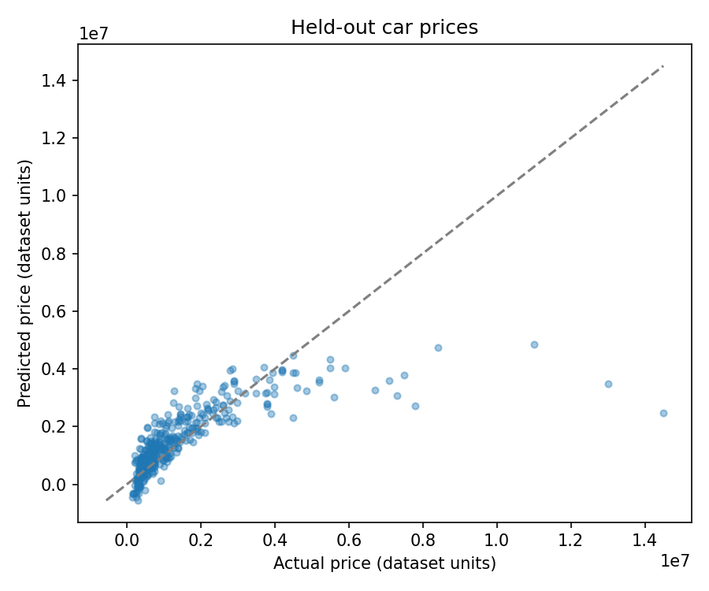

# Used Car Price Analysis

Guided training project by Jyotsna Konchada, revised with ChatGPT assistance.

## Purpose and method

Select year, mileage, brand, model, fuel type, and city. Exclude row ID and undocumented brand_rank. Split 70/30 with random_state=10; fit imputation, scaling, one-hot encoding, and fixed-alpha Ridge on training data. Retain valid expensive cars. Compare against the training-mean baseline.

## Verified results

| model | MAE | RMSE | R2 |
| --- | --- | --- | --- |
| Training mean baseline | 1096229.7267 | 1690702.2431 | -0.0014 |
| One-hot Ridge regression | 571761.2936 | 1139866.7501 | 0.5448 |

The original saved R² was 0.32046 after filtering to 1511 rows. This revised run retains a different scope of data, so the scores are not a controlled before/after comparison. RMSE and MAE use the original price units; currency is not confirmed.



## Run locally

Tested with Python 3.12.14 and the package versions in requirements.txt.

```bash
python -m venv .venv
# Windows: .venv\Scripts\activate
# macOS/Linux: source .venv/bin/activate
python -m pip install -r requirements.txt
jupyter notebook
```

Open notebooks/analysis.ipynb and use Restart Kernel and Run All. Launch Jupyter from this repository's root or its notebooks folder. Data is read from data/ and outputs are written to reports/. The delivered notebook includes outputs from a successful sequential run of every code cell.

## Learning support and contribution

Based on the uploaded training notebook `Project_Cars_prediction.ipynb` and matching dataset. The original work explored this topic as a class/practice exercise. ChatGPT assisted with restructuring code, explaining the method, correcting issues, executing the revised cells, and drafting documentation. I should review and understand these changes before discussing the project in an interview. Course/instructor attribution and my specific independent changes still need to be confirmed.

## Limitations

One random split does not establish performance in a new market or time period. Expensive cars and rare categories remain difficult; negative predictions are possible. No multiple-dataset merge was present in the source notebook.

## Data provenance

Dataset supplied from training files. Original publisher, license, and collection date are not established in the supplied materials. Confirm permission before publishing the data or course-derived code. If data cannot be shared, remove it from the repository and document the permitted retrieval route. No distribution license is asserted by this package.

## Proposed repository

https://github.com/jyotsnak-444/used-car-price-analysis

This is a proposed address, not a published repository.
